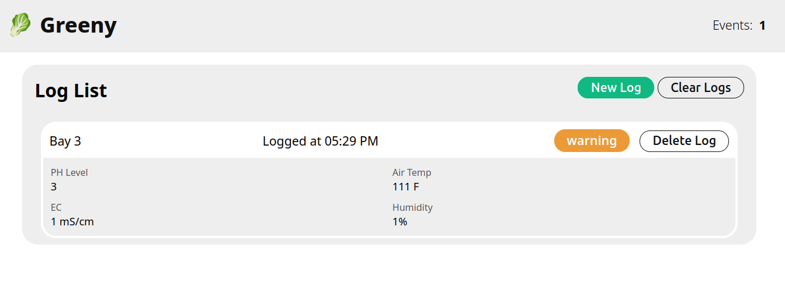

# web-dashboard-demo
A undergrad web design project to create a dashboard web application. I chose to use the hypothetical company 'Greeny'.



## Assignment 2A

### Don Norman Less-than-equal-4-click User Journey Funnel
- **Starting state:** When the UI loads, the user will be presented with a top bar containing a logo on the left side and a total reading indicator on the right side. The Body of the page will show a dynamic list display of reading logs. Around this section will be user action buttons for actions such as creating a new log entry.
- **Action 1:** Users will enter data regarding the greenhouse sensor event into the fields provided in the log event form. Each field will have HTML & Javascript constraints for range of valid data to enter as well as requireing different fields to be non-blank.
- **Action 2:** When the user selects the 'submit' button on the form, data entered will be checked against constraints defined in the Javascript. 
- **Action 3:** After selecting 'submit', If data is valid, a new log section will be injected to the dynamic log entry list container via the javascript code. If data is not valid, the data entry fields will glow red to indicate invalid data entry.
- **Action 4:** Users can interact with the output portion of the UI by scrolling up and down to view all entries in the list. They will be able to delete logs from the dynamic list by clicking 'delete' on the entry. They may also edit an entry by selecting 'edit' on each entry.
- **Terminal State:** When the user has 'completed' their interaction with the app, their submitted entry will be visible in the dynamic log entry list section. 

### Don Norman Usability & Constraint Audit
| Norman Principal/Concept | System Context | Answers |
|--------------------------|----------------|---------|
| Gulf of Execution | Typing numeric sensor metrics | Labels include example entries in brackets. HTML elements use built-in input constraints to enforce format such as the 'step' element. |
| Gulf of Evaluation | Ingesting sensor values | System immediatly communicates whether a input is normal, warning, or hazard by showing a status element containing the value. |
| System Constraint | Water pH Boundaries | HTML elements such as 'min' and 'max' prevent input of impossible pH values. The text input box turns red if improper data is submitted. |
| Visual Feedback State | Real-Time input error/ out of bounds | The input field will turn red on upon entering a value that is improper/ violates valid constraints. |
| Error Recovery | Accidental or test data submissions | User is able to delete entries via individual delete buttons or delete all entries with universal delete button. |

### Document Object Model Tree Architecture

**index.html**
```html
    - <header class="site-header">
        - <div class="logo">
            - <a href="/">
        - <div class="indicator-group">
    - <main>
        - <section class="control-bar">
            - <h2>Log List</h2>
            - <button class="btn btn-primary">New Log</button>
            - <button class="btn btn-secondary">Clear Logs</button>
        - <section id="log-entry-grid" class="log-entry-grid">
            <!-- Dynamic entry section injection -->
            - <h4>Bay {id}</h4>
            - <p>PH {ph}</p>
            - <p>Temp {temp}</p>
            - <p>EC {ec}</p>
            - <p>RH {rh}</p>
            - <p>Status {status}</p>
            - <button class="btn">Delete Entry</button>
            - <button class="btn">Edit Entry</button> <!-- Reuses log entry modal -->
            <!-- Dynamic entry section injection -->
        - <div id="log-entry-modal" class="modal log-entry-modal">
            - <h3>New Log Entry</h3>
            - <form id="entry-form" class="entry-form">
                - <label for="bay-id">Bay ID</label>
                - <input type="text" id="bay-id" name="bay-id" placeholder="EX: Bay 3423" required>
                - <label for="ph-input">pH Level (0.00 -- 14.00)</label>
                - <input type="number" id="ph-input" name="ph-input" placeholder="7.00" min="0" max="14" step="0.01" required>
                - <label for="temp-input">Bay Air Temp (F)</label>
                - <input type="number" id="temp-input" name="temp-input" placeholder="85" min="0" max="212" step="0.1" required>
                - <label for="ec-input">EC (mS/cm)</label>
                - <input type="number" id="ec-input" name="ec-input" placeholder="1.00" min="0" max="10" step="0.01" required>
                - <label for="rh-input">Humidity (% RH)</label>
                - <input type="number" id="rh-input" name="rh-input" placeholder="60.00" min="0" max="100" step="0.1" required>
                - <button type="button" id="cancel-btn" class="btn btn-secondary">Cancel</button>
                - <button type="submit" class="btn btn-primary">Submit Entry</button>
            <!-- Dynamic Hidden div to display success/error messages -->
            - <div class="feedback-message">
            <!-- Dynamic Hidden div to display success/error messages -->
    - <footer>
        - <p>Copywright 2026 Greeny Inc.</p>
```

### Data Schema

**app.js**
```javascript
// log entry object
const logEntrySchema = {
    id: "number",   // number representing unique id of the log entry
    bayId: bay-id,  // number representing ID of the greenhouse bay
    timestamp: "number",    // number representing exact time of entry log creation
    ph: ph-input,   // number representing PH level
    temp: temp-input,   // number representing temp in F
    ec: ec-input,   // number representing electronic conductivity
    rh: rh-input,   // number representing relative humidity percent
    status: "string"    // string representing the severity status of log based on adjacent inputs
};

// Event listeners
newEntryModalBtn.addEventListener('click') // open new entry modal to expose new entry form
clearAllEntryBtn.addEventListener('click')  // delete all log entries on page
editEntryModalBtn.addEventListener('click') // edit the details of an entry log
cancelNewEntryModal.addEventListener('click')   // close new entry modal (cancel action)
validateInputEntryModal.addEventListener('input') // check input values to ensure valid agianst constraints.
submitNewEntryModal.addEventListener('submit')   // Submit new entry modal form
```
